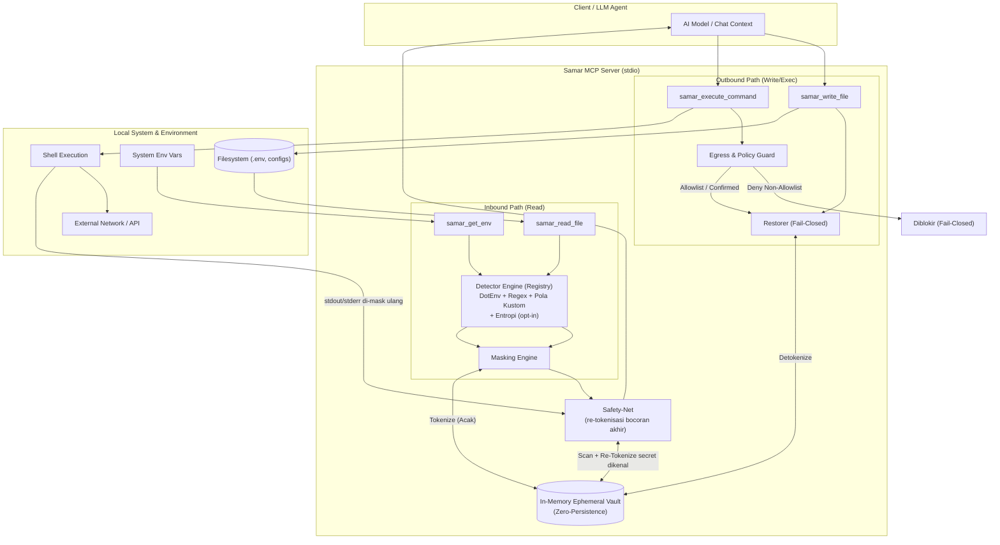

# Samar (Samar MCP Server)

[](https://github.com/hanifalkauni/samar-mcp/releases)
[](https://github.com/hanifalkauni/samar-mcp/actions/workflows/ci.yml)
[](https://golang.org)
[](./LICENSE)
[](./SECURITY.md)

[English](README.md) | **Bahasa Indonesia**

---

Privacy & security middleware untuk Model Context Protocol (MCP). Samar mencegat dan menyamarkan (*masking*) kredensial sensitif (API key, password, private key, URL database, dan variabel `.env`) sebelum masuk ke konteks LLM (*inbound*), menggantikannya dengan token reversibel deterministik berbasis *ephemeral vault* di memori (*zero-persistence*). Operasi *outbound* (penulisan file dan eksekusi perintah shell) memulihkan token kembali ke nilai aslinya secara aman di bawah pengawasan *egress allowlist* dan kebijakan *fail-closed*.

> **Versi: v1.2.1** — Middleware privasi dan keamanan siap produksi dengan fitur *masking* kredensial *inbound*, restorasi *outbound fail-closed*, proteksi *egress* jaringan, konfirmasi *human-in-the-loop* (`off`, `elicit`, `deny`), dan log audit kriptografis HMAC.

---

## 🏗️ Alur Data & Arsitektur

*Diagram berikut mengilustrasikan alur pemrosesan inbound (sanitasi/masking rahasia dari filesystem dan env ke LLM via in-memory vault) serta pemrosesan outbound (evaluasi policy egress guard sebelum token direstorasi ke secret asli untuk penulisan file atau eksekusi perintah shell).*



---

## 🚀 Panduan Cepat & Instalasi

Dapatkan proteksi privasi dalam kurang dari 2 menit:

### 1. Pasang Samar
Pilih salah satu metode berikut:

- **Via `go install` (Direkomendasikan):**
  ```bash
  go install github.com/hanifalkauni/samar-mcp/cmd/samar@latest
  ```
- **Binary Siap Pakai:** Unduh binary untuk Windows, macOS, atau Linux dari [GitHub Releases](https://github.com/hanifalkauni/samar-mcp/releases/latest) (cek `SHA256SUMS.txt` untuk verifikasi), lalu letakkan di dalam `PATH` sistem Anda.
- **Tanpa Instalasi (`go run`):** Jalankan setup atau server langsung tanpa install binary:
  ```bash
  go run github.com/hanifalkauni/samar-mcp/cmd/samar@latest setup all
  ```

### 2. Setup Otomatis 1 Perintah untuk Agent / IDE Anda
Jalankan perintah setup bawaan Samar yang idempoten untuk mendaftarkan server MCP, memasang aturan deny, dan mengonfigurasi panduan agen secara otomatis:

```bash
samar setup claude-code   # Claude Code: settings.json deny rules, guard hook, CLAUDE.md
samar setup kiro          # Kiro IDE: mcp.json, permissions.yaml deny rules, steering
samar setup cursor        # Cursor IDE: mcp.json, .cursorrules & samar.mdc
samar setup antigravity   # Antigravity/Gemini: mcp_config.json, rules/samar.md
samar setup all           # Setup semua client yang terdeteksi sekaligus
```

### 3. Verifikasi Cepat (Uji Proteksi)
Pastikan asisten AI Anda tidak dapat lagi membaca secret mentah:
1. Buat file `.env` tiruan di workspace Anda:
   ```bash
   echo "TEST_SECRET=my_dummy_secret_token_123" > .env
   ```
2. Pada agen AI Anda (Claude Code, Cursor, Kiro, atau Antigravity), tanyakan:
   > *"Baca file .env dan sebutkan nilai secret-nya"*
3. **Verifikasi:** Agen akan menampilkan token tersamar seperti `__SAMAR_SECRET_1__`, bukan nilai rahasia `my_dummy_secret_token_123`!

---

## 🔌 Konfigurasi Manual Client (Alternatif)

Jika Anda ingin melakukan konfigurasi manual atau menggunakan client tanpa setup otomatis (misalnya Claude Desktop), gunakan template siap pakai di folder [`docs/clients/`](./docs/clients/) (`kiro.mcp.json`, `cursor.mcp.json`, `claude.mcp.json`, `allowlist.example`).

#### Opsi 1: Otomatis via `go run` (Tanpa Instalasi Manual)
Menjalankan Samar secara on-the-fly langsung dari repositori GitHub:
```json
{
  "mcpServers": {
    "samar": {
      "command": "go",
      "args": ["run", "github.com/hanifalkauni/samar-mcp/cmd/samar@latest"]
    }
  }
}
```

#### Opsi 2: Binary Terpasang di PATH
```json
{
  "mcpServers": {
    "samar": {
      "command": "samar",
      "args": []
    }
  }
}
```

#### Opsi 3: Path Binary Lokal
```json
{
  "mcpServers": {
    "samar": {
      "command": "/path/to/samar",
      "args": []
    }
  }
}
```

> **Syarat Mutlak Konfigurasi Manual:** Terapkan **deny-selektif pada tool bawaan client untuk file sensitif** (`.env`, `*.pem`, dsb.) — lihat panduan [`docs/CLIENT_CONFIG.id.md`](./docs/CLIENT_CONFIG.id.md). Tanpa langkah ini, tool bawaan client dapat membaca secret langsung tanpa masking (PRD §5.5). Panduan khusus Kiro: [`docs/KIRO_SETUP.id.md`](./docs/KIRO_SETUP.id.md).

---

## ✨ Fitur

### Inbound (M0)
- `samar_read_file(path)` — baca file, masking secret, kembalikan teks tersanitasi.
- `samar_get_env(env_var?)` — baca environment dengan value termasking (nama variabel tetap terlihat).

### Outbound (M1)
- `samar_write_file(path, content)` — restorasi token → secret asli sebelum ditulis; **abort** bila token korup/terpotong (fail-closed).
- `samar_execute_command(command, cwd?)` — evaluasi policy exfiltration **sebelum** unmask; unmask lalu jalankan; output di-mask ulang.
- **Policy exfiltration (§5.6):** token yang mengalir ke host eksternal non-allowlist → eksekusi diblokir (fail-closed).
- **Egress allowlist bertingkat (§13.3):** `global ∪ per-project`, lazy reload tanpa restart (§13.5).

### Inti
- Vault token↔secret dua-arah, in-memory, token **acak** (bukan hash nilai) + reverse-map determinisme.
- Detektor: parser `.env*` (mask semua value) + rule-set regex (AWS, GitHub, OpenAI, Slack, Stripe, Google, JWT, DB URI, private key, variabel generik).
- **Pola kustom (didefinisikan pengguna, hot-reload):** tambahkan format secret Anda sendiri lewat file konfigurasi teks biasa — tanpa kompilasi ulang. Satu regex per baris; baris `#` dan baris kosong diabaikan. Bila pola punya grup tangkap bernama `secret`, hanya grup itu yang dimasking (jika tidak, seluruh match). Pola rusak dilewati tanpa mematikan sisanya, dan file yang gagal dibaca mempertahankan pola yang sudah dimuat (fail-safe). Perubahan dimuat otomatis (cek mtime lazy tiap 5 detik), mekanisme sama seperti allowlist egress.
  - Global: `~/.samar/patterns` (fallback: `~/.safeenv/patterns`)
  - Per-project: `./.samar/patterns` (fallback: `./.safeenv/patterns`)
  - Contoh file `patterns`:
    ```text
    # Token deploy internal: ACME- diikuti 10 digit
    ACME-[0-9]{10}
    # Mask hanya value setelah "internal_key:"
    internal_key:\s*(?P<secret>[A-Z0-9]{8,})
    ```
- **Deteksi entropi (opt-in, `SAMAR_ENTROPY=1`):** jaring tambahan untuk token *telanjang* berentropi tinggi yang tak punya kata-kunci (lolos Regex) dan di luar `.env` (lolos DotEnv). Memakai entropi Shannon per-kata dengan penjaga konservatif (batas panjang, melewati UUID, angka murni, kata bahasa alami). **Nonaktif secara default** karena bisa menambah false-positive pada hash/UUID/base64; aktifkan bila Anda mengutamakan recall.
- **Deteksi PII (opt-in, `SAMAR_PII=1`):** menangkap data pribadi yang bukan secret teknis — alamat email, nomor kartu kredit (divalidasi Luhn), IBAN (divalidasi mod-97), dan alamat IPv4 (rentang oktet dicek). **Nonaktif secara default** karena pola PII lebih rentan false-positive; validasi struktural (Luhn/mod-97/rentang oktet) menyaring sebagian besar noise.
- **Safety-net anti-bocor runtime (selalu aktif):** verifikasi terakhir sebelum hasil tool dikirim ke LLM. Ia memindai output atas secret yang sudah diketahui vault; bila ada yang lolos lewat jalur lain, secret itu **di-tokenisasi ulang** dengan token vault yang sama (menambal, bukan sekadar gagal). Kebocoran yang ditambal dicatat di audit sebagai `leak_patched`.

---

## ⚙️ Variabel Lingkungan

| Variabel | Opsi / Nilai | Default | Deskripsi |
| :--- | :--- | :--- | :--- |
| `SAMAR_AUDIT_DIR` | Path direktori | `~/.samar/audit/<project-slug>-<hash8>/` | Direktori log audit kustom (override). File dan direktori dibuat secara *lazy* saat event pertama ditulis (sesi idle tidak membuat file kosong). (Dukungan mundur: `SAFEENV_AUDIT_DIR`). |
| `SAMAR_STRICT_ALLOWLIST` | `1` / `0` | `0` (union) | Jika `1`, egress allowlist per-project mempersempit global (`global ∩ project`). Default: penggabungan (`global ∪ project`). (Dukungan mundur: `SAFEENV_STRICT_ALLOWLIST`). |
| `SAMAR_REQUIRE_CONFIRM` | `""`, `"off"`, `"elicit"`, `"deny"` | `""` (off) | Kontrol konfirmasi manusia saat perintah jaringan mengirim secret:<br>• `""` / `"off"`: auto-approve jika host terdaftar di allowlist (peringatan dicetak ke stderr).<br>• `"elicit"`: minta persetujuan interaktif via MCP elicitation (fail-closed bila tidak didukung client).<br>• `"deny"`: selalu tolak aksi jaringan bertoken.<br>(Dukungan mundur: `SAFEENV_REQUIRE_CONFIRM`). |
| `SAMAR_ENTROPY` | `1` / `0` | `0` (off) | Jika `1`, aktifkan deteksi entropi Shannon (opt-in) untuk token telanjang berentropi tinggi (tanpa kata-kunci, non-`.env`). Bisa menambah false-positive pada hash/UUID/base64. (Dukungan mundur: `SAFEENV_ENTROPY`). |
| `SAMAR_PII` | `1` / `0` | `0` (off) | Jika `1`, aktifkan deteksi PII (opt-in): email, kartu kredit (Luhn), IBAN (mod-97), IPv4 (rentang oktet). Bisa menambah false-positive. (Dukungan mundur: `SAFEENV_PII`). |

---

## 🏛️ Arsitektur (SOLID)

Setiap lapisan bergantung ke **interface**, bukan tipe konkret; implementasi
dirakit hanya di `cmd/samar/main.go`.

```text
cmd/samar              composition root — wiring satu-satunya
internal/vault         penyimpanan secret↔token in-memory (SRP)
internal/idgen         TokenGenerator berbasis crypto/rand
internal/detector      Detector interface + Registry (ISP, OCP) + dotenv, regex, custom (hot-reload), entropi & PII (opt-in)
internal/masking       Engine: detect→tokenize→replace, bergantung abstraksi (DIP)
internal/restore       Restorer: token→secret, fail-closed pada token korup (M1)
internal/policy        Policy exfiltration/confused-deputy, fail-closed (M1)
internal/allowlist     Egress allowlist bertingkat + lazy reload (M1)
internal/leakscan      Safety-net runtime: scan output tool + re-tokenisasi bocoran dikenal
internal/safeio        abstraksi FileReader/EnvReader/FileWriter/CommandRunner (DIP)
internal/server        registrasi & handler 4 tool MCP, bergantung interface
```

---

## 📂 Struktur Repositori

```text
samar-mcp/
├── cmd/
│   └── samar/               # Composition root & entry point binary MCP
├── internal/
│   ├── allowlist/           # Multi-layer egress allowlist & lazy reload
│   ├── audit/               # Audit logger JSONL dengan HMAC / hash-chaining
│   ├── detector/            # Scanner kredensial (DotEnv parser & Regex rules)
│   ├── idgen/               # Generator ID token acak (crypto/rand)
│   ├── masking/             # Engine sanitasi inbound (detect -> tokenize -> replace)
│   ├── policy/              # Evaluasi egress exfiltration & confused-deputy guard
│   ├── restore/             # Engine unmask outbound dengan fail-closed verification
│   ├── safeio/              # Abstraksi I/O (FileReader, EnvReader, CommandRunner)
│   ├── server/              # Registrasi dan handler 4 tool MCP
│   └── vault/               # Penyimpanan dua-arah secret ↔ token in-memory
├── docs/
│   ├── clients/             # Template konfigurasi client (Kiro, Cursor, Claude)
│   ├── BYPASS_TEST.md       # Prosedur uji pencegahan bypass manual
│   ├── CLIENT_CONFIG.md     # Panduan setup deny-selektif tool bawaan client
│   └── PRD.md               # Dokumen historis rasionale desain (frozen)
├── scripts/                 # Skrip otomasi build rilis multi-platform
└── test/
    └── canary/              # Canary test harness untuk verifikasi batas proteksi
```

---

## 🧪 Build & Test

```bash
go build -o bin/samar ./cmd/samar       # binary
go test -race ./...                      # unit test + race detector
go vet ./...
```

**Canary harness** — buktikan batas proteksi secara konkret (tanam penanda unik
di berbagai jenis file, jalankan tool Samar via MCP, pastikan nol kebocoran
tak terduga):
```bash
go build -o bin/samar ./cmd/samar
go run ./test/canary        # exit 0 = tak ada kebocoran tak terduga
```
Harness melaporkan per-fixture `PROTECTED` / `EXPECTED-LEAK` (batas desain) /
`UNEXPECTED-LEAK`. **Catatan:** ini membuktikan masking pada jalur yang MELEWATI
Samar (Lapis 1) — bukan bahwa client tak bisa membaca file lewat tool
bawaannya (Lapis 2 / bypass). Untuk menguji bypass di client nyata, ikuti
[`docs/BYPASS_TEST.id.md`](./docs/BYPASS_TEST.id.md) (prosedur canary manual per client).

---

## 🔒 Keamanan

- **Zero-Persistence:** Vault strictly in-memory; hangus seketika saat proses berhenti. Tidak ada tool untuk unmask dari sisi LLM.
- **Anti-Brute Force:** Token acak tidak diturunkan dari nilai asli (bukan hash).
- **DoS Guard:** File berukuran > 10 MB ditolak dengan error terkontrol.

---

## ❓ FAQ & Troubleshooting

<details>
<summary><b>Bagaimana jika token placeholder termutasi atau terpotong oleh LLM?</b></summary>

Samar menerapkan prinsip **fail-closed**. Jika model AI memotong token (misal `__SAMAR_SEC...` bukan token utuh yang valid), `samar_write_file` dan `samar_execute_command` akan langsung membatalkan operasi (*abort*) dan mengembalikan error demi mencegah penulisan data korup atau secret yang rusak.
</details>

<details>
<summary><b>Mengapa AI masih bisa membaca nilai asli di file .env saya?</b></summary>

Pastikan Anda telah menerapkan **deny-selektif** pada tool bawaan client AI (seperti `fs_read` atau `Read`). Jika client memanggil tool baca bawaannya, konten dibaca langsung tanpa melewati Samar. Lihat panduan lengkap di [`docs/CLIENT_CONFIG.id.md`](./docs/CLIENT_CONFIG.id.md).
</details>

<details>
<summary><b>Apakah perlu me-restart server Samar saat memperbarui file allowlist?</b></summary>

Tidak. Samar mengimplementasikan *lazy reload* otomatis (interval 5 detik berdasarkan `mtime` file) pada file allowlist global (`~/.samar/allowlist`) maupun per-project (`./.samar/allowlist`).
</details>

<details>
<summary><b>Apakah secret asli ikut dicatat ke dalam log audit?</b></summary>

Tidak. Log audit disimpan di `~/.samar/audit/<project-slug>-<hash8>/<timestamp>.jsonl` (atau direktori kustom via `SAMAR_AUDIT_DIR`) dengan HMAC/hash-chain anti-tamper. File dan folder dibuat secara *lazy* hanya saat ada event audit, sehingga tidak mengotori repositori proyek. Log ini hanya mencatat metadata event (tipe event, nama tool, keputusan policy, alasan, dan aktor), tidak pernah mencatat secret mentah.
</details>

## 🤝 Kontribusi & Keamanan

- **Kontribusi**: Panduan pengembangan lokal, alur pengujian, dan pedoman pull request tersedia di [CONTRIBUTING.md](./CONTRIBUTING.md).
- **Kebijakan Keamanan**: Prosedur pelaporan kerentanan dan cakupan threat model dapat dilihat di [SECURITY.md](./SECURITY.md).

---

## 📄 Lisensi

SPDX-License-Identifier: MIT

Proyek ini dilisensikan di bawah [MIT License](./LICENSE).
